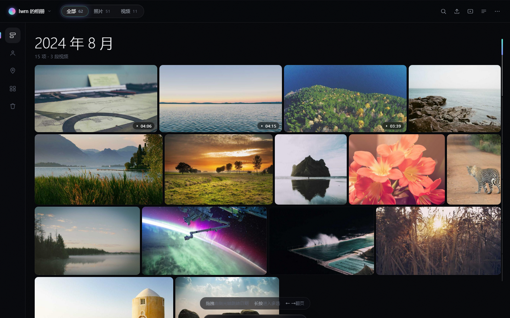
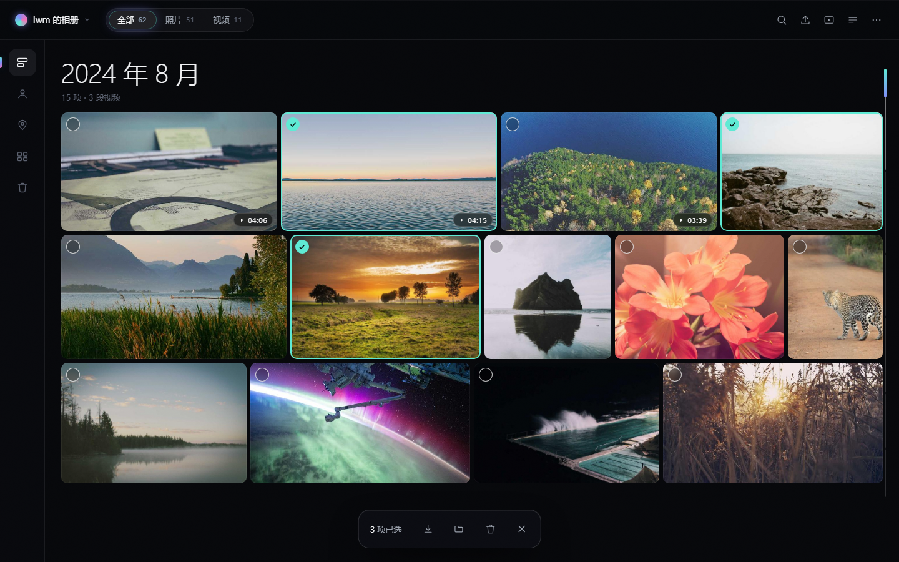
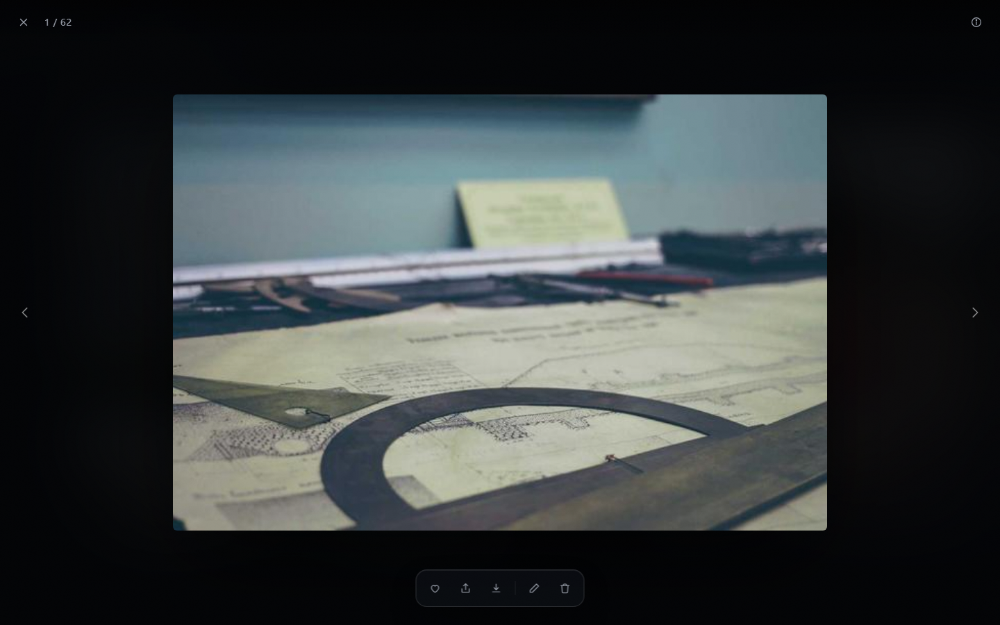
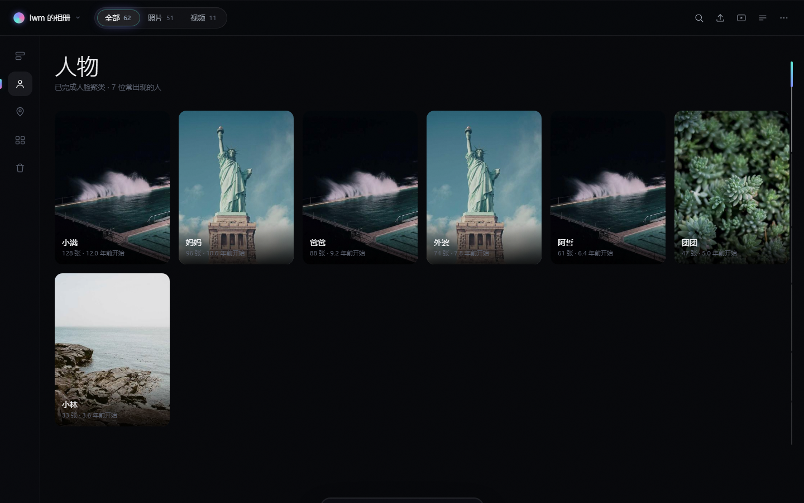
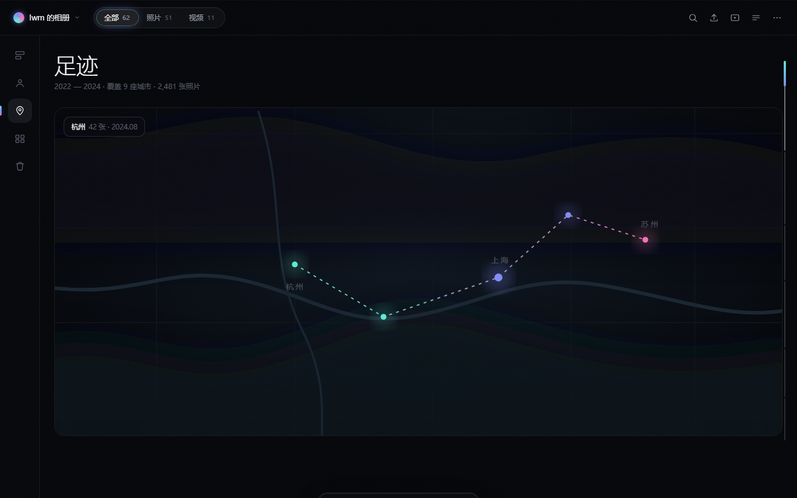
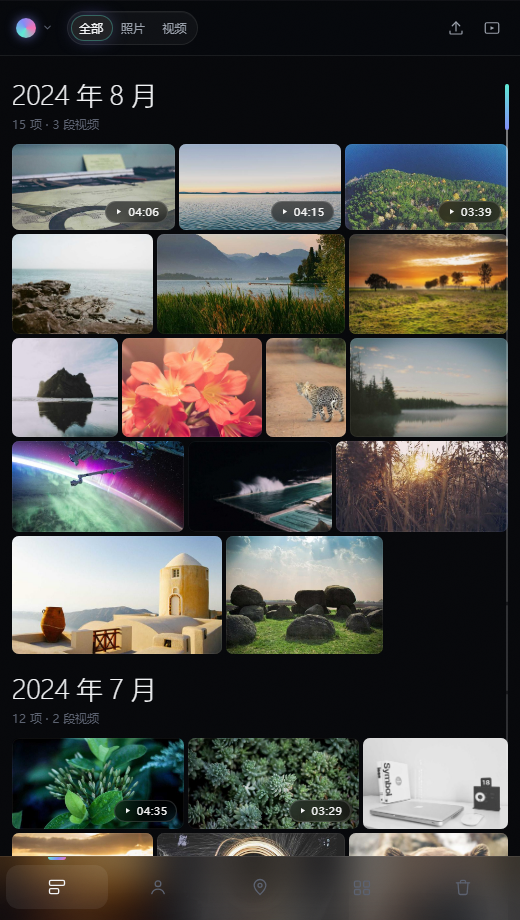

# 拾光 · Shíguāng

> 把家里的老照片，安安静静地放在自己家的硬盘上。
>
> 一台路由器，一块移动硬盘，一个不依赖任何云服务的家庭照片云。

<p align="center">
  
</p>

<p align="center">
  
  
  
  
  
</p>

---

## 为什么做这个

家里十几年的照片，散落在旧手机、微信收藏、相机存储卡里。

网盘要会员、会限速、会关停；NAS 动辄几千块，还要维护 RAID。

**拾光**选择另一条路：把照片放在一台吃灰的 OpenWrt 路由器 + 一块 1.8TB 移动硬盘上，
全家人的手机、电脑在局域网里随时翻看，数据一个字节都不出家门。

整套系统跑在 **837MB 内存的路由器**上，稳定服务 5000+ 张照片、128 段视频。

---

## 2.1 更新（安卓 2.0）

- 上传任务持久保存，支持暂停、继续、失败重试和取消。
- 手机与网页新增组合搜索、常用筛选和更清晰的加载状态。
- 管理员可创建独立成员空间，设置共享权限及上传配额。
- 人脸增量归类保留人工命名与纠错，支持人物合并、拆分及相似照片对比。
- 电脑端识别工具支持持续检查新增照片。

详见 [升级说明与验证记录](docs/upgrading-2.1.md)。


## 功能

<table>
<tr>
<td width="50%" valign="top">

**🗓 时间轴**
按月份分组的时间轴，瀑布流布局，滑到底自动加载下一屏。

**🔒 三个隔离分区**
我的照片 / 家庭共享 / 私密相册，各自独立，互不干扰。

**🏠 家庭共享**
用**硬链接**实现：推送不占额外空间，删除互不影响。

**📁 文件夹与相册**
按目录聚合，也支持手动创建相册、批量整理。

</td>
<td width="50%" valign="top">

**📱 自动备份**
App 扫描手机相册，按文件夹选范围，支持直接备份进私密相册。

**🎬 视频边下边播**
服务端无解码器也能播：客户端分段并发下载 + 本地代理播放。

**⚡ 批量操作**
多选删除、移入私密、推送共享、收藏、打包 ZIP。

**🗄 数据库每日备份**
内置定时任务，压缩后保留 14 天，不依赖任何外部工具。

</td>
</tr>
</table>

---

## 界面

| 时间轴 | 多选批量 | 查看器 |
|---|---|---|
|  |  |  |

| 人物 | 地点 | 手机端 |
|---|---|---|
|  |  |  |

---

## 架构

```
        ┌─────────────────────────────────────────────┐
        │           手机 App（纯 Java，零依赖）         │
        │   网格浏览 · 多指缩放 · 备份 · 边下边播        │
        └───────────────────┬─────────────────────────┘
                            │  HTTP (局域网)
        ┌───────────────────┴─────────────────────────┐
        │   浏览器（原生 JS SPA，内嵌进二进制）          │
        │   时间轴 · 三分区 · 多选 · 拖拽定位            │
        └───────────────────┬─────────────────────────┘
                            │
        ┌───────────────────┴─────────────────────────┐
        │         Go 服务端（单二进制，~10MB）           │
        │  SQLite 索引 · 缩略图队列 · 硬链接共享         │
        │  定时备份 · 上传分片 · 内存上限 128MB          │
        └───────────────────┬─────────────────────────┘
                            │
        ┌───────────────────┴─────────────────────────┐
        │      OpenWrt 路由器 + USB 移动硬盘（ext4）     │
        │           照片 / 视频 / 索引数据库             │
        └─────────────────────────────────────────────┘
```

---

## 技术选择

| 决策 | 原因 |
|---|---|
| **Go 单二进制** | 交叉编译成 arm64，扔到路由器就能跑，无需运行时 |
| **SQLite 索引** | 一个文件、零运维，几万条记录毫秒级查询 |
| **网页 `go:embed`** | 前后端一起打包，部署只需拷一个文件 |
| **App 零第三方依赖** | 不用 Gradle、不用 AndroidX，`aapt2 + javac + d8` 直接出 APK |
| **硬链接做共享** | 推送 1800 张照片，磁盘占用几乎不变 |
| **客户端截帧** | 路由器 ffmpeg 没有 H.264/HEVC 解码器，视频封面由手机生成 |

---

## 快速开始

### 服务端

```bash
cd server
CGO_ENABLED=0 GOOS=linux GOARCH=arm64 \
  go build -trimpath -ldflags "-s -w" -o lumina-arm64 .
```

拷贝到路由器后：

```bash
scp lumina-arm64 root@192.168.2.1:/tmp/
ssh root@192.168.2.1 'chmod +x /tmp/lumina-arm64 && sh /tmp/deploy.sh /tmp/lumina-arm64'
```

首次启动会创建管理员账号：

```bash
export LUMINA_ADMIN_PW='你的初始密码'   # 不设置则随机生成并打印在日志
```

> 部署后第一件事就是登录改密码。服务默认监听 `:8088`，仅建议在局域网使用。

### Android App

```powershell
cd android
$env:LUMINA_KS_PASS = "你的keystore口令"
./build.ps1
```

只用 Android SDK 自带工具链，不需要 Gradle。
签名用的 `lumina-release.jks` **不在仓库里**，自己生成：

```bash
keytool -genkeypair -keystore lumina-release.jks -alias lumina \
  -keyalg RSA -keysize 2048 -validity 10000
```

---

## 性能

在 837MB 内存、四核 ARM 的 OpenWrt 路由器上实测：

| 指标 | 数值 |
|---|---|
| 常驻内存 | ~156 MB |
| 冷启动扫描 5300 个文件 | ~10 秒 |
| 缩略图并发 | 1（`nice -n 19`，不抢前台资源） |
| 数据库备份 | 4.3 MB → 1.2 MB，0.6 秒 |
| 视频播放 | 单连接 1.3 MB/s，8 路并发 ~9.5 MB/s |

---

## 路线图

- [x] 时间轴 / 文件夹 / 相册 / 回收站
- [x] 三分区隔离（我的 / 共享 / 私密）
- [x] 手机自动备份 + 一键补预览 + 补视频封面
- [x] 视频边下边播
- [x] 数据库每日备份
- [ ] 手机端本地转码（720p 副本推到路由器，彻底告别缓冲）
- [ ] 相册分享链接（限时、只读）
- [ ] WebDAV 挂载

---

## 说明

- 所有数据都在自己的硬盘上，不依赖任何云服务
- 服务端为低配设备做了大量取舍：内存上限、缩略图并发、后台任务让路
- 项目只用标准库与 SQLite 驱动，其余一律手写（HTTP 客户端、缩略图队列、并发下载器）

---

<p align="center"><sub>拾起散落的时光</sub></p>
